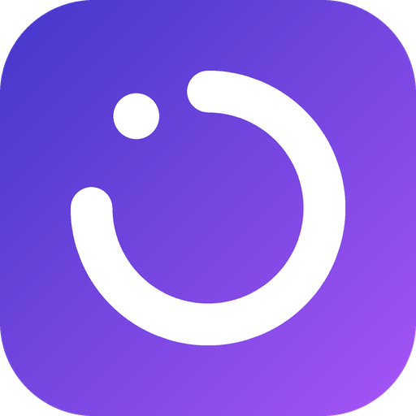

<p align="center">
  
</p>

<h1 align="center">Напоминатор</h1>

<p align="center">
  <b>Трекер привычек и целей, который не даёт тихо забить.</b><br>
  Пропустил день — цель не исчезает, а переезжает на завтра и ждёт, пока ты её сделаешь.
</p>

<p align="center">
  <a href="https://github.com/spyridonmibers/napominator/releases/latest/download/napominator.apk"><b>Скачать для Android</b></a>
  &nbsp;·&nbsp;
  <a href="https://github.com/spyridonmibers/napominator/releases/latest/download/napominator.ipa"><b>Скачать для iPhone</b></a>
  &nbsp;·&nbsp;
  <a href="https://github.com/spyridonmibers/napominator/releases">Все версии</a>
</p>

---

## Зачем это нужно

Обычные трекеры привычек прощают пропуски: не отметил — день сгорел, и никто о нём не вспомнит. Так и бросают: один пропуск, второй, и цель тихо умирает.

Напоминатор устроен иначе. **Невыполненная цель остаётся с тобой**, пока ты её не сделаешь. Если сегодня не получилось позаниматься английским, завтра он снова будет первым в списке, а расписание само подстроится. Ничего не теряется, ничего не нужно пересчитывать в голове.

## Что умеет

**Цели под любой ритм**
- До 50 целей одновременно
- Каждый день, через день, по дням недели или свой график: 2/2, 3/1, 5/2 и любой другой
- Срок на выбор: бессрочно, до определённой даты или N раз (например, «30 тренировок»)

**Ты решаешь, что будет при пропуске** — отдельно для каждой цели:
- **Переносить и сдвигать график.** Цель переедет на завтра, а всё расписание и дата окончания сдвинутся на день. Было Пн/Ср/Пт, пропустил среду — дальше Чт, Сб, Пн.
- **Переносить, график не менять.** Цель переедет на завтра, а следующие дни пойдут по плану.
- **Не переносить.** Пропуск засчитывается, цель ждёт следующего дня по графику.

**Напоминания, которые не теряются**
- Напоминание висит в уведомлениях, пока цель не отмечена. Отметить можно прямо из уведомления, приложение открывать не нужно.
- **Цели на экране блокировки.** На Android — список целей прямо на заблокированном экране, отметка одним касанием. На iPhone — Dynamic Island и Live Activity.
- **Виджет для Android:** прогресс за день и список целей на рабочем столе, отмечать можно прямо там.
- Время напоминания — колесом или циферблатом, плюс быстрые кнопки «Утро / День / Вечер / Перед сном».

**Видно прогресс**
- Экран «Сегодня» с кольцом прогресса за день
- Календарь всех целей: что выполнено, что перенесено, что впереди
- Серии дней подряд, лучшая серия, история за 16 недель у каждой цели
- Архив достигнутых и отложенных целей

**Выглядит так, как тебе нравится**
- Светлая и тёмная тема, 10 акцентных цветов
- 40 иконок и 10 цветов для целей
- 5 вариантов иконки приложения на рабочем столе

**Честно по отношению к тебе**
- Без регистрации, рекламы и подписок
- Все данные хранятся только на телефоне и никуда не отправляются

## Как установить

### Android

1. Откройте на телефоне ссылку **[Скачать для Android](https://github.com/spyridonmibers/napominator/releases/latest/download/napominator.apk)**.
2. Откройте скачанный файл. Если телефон спросит, разрешите установку из этого источника.
3. При первом запуске разрешите уведомления и «Будильники и напоминания» — без них напоминания не придут вовремя.

Новые версии ставятся поверх старой, цели сохраняются.

### iPhone

Приложения нет в App Store, поэтому iPhone ставится через компьютер с бесплатной программой [Sideloadly](https://sideloadly.io). Это займёт около 10 минут.

1. Скачайте **[napominator.ipa](https://github.com/spyridonmibers/napominator/releases/latest/download/napominator.ipa)** на компьютер и установите Sideloadly.
2. Подключите iPhone кабелем, перетащите файл в Sideloadly, введите Apple ID и нажмите **Start**.
3. На iPhone: **Настройки → Основные → VPN и управление устройством** → доверять своему Apple ID.
4. На iOS 16 и новее: **Настройки → Конфиденциальность и безопасность → Режим разработчика** → включить.

С бесплатным Apple ID установка работает 7 дней. Потом повторите шаг 2 — цели сохранятся.

## Частые вопросы

**Это бесплатно?**
Да, полностью.

**Куда уходят мои данные?**
Никуда. Цели и история хранятся только на вашем телефоне.

**Почему на iPhone так сложно ставить?**
Apple разрешает устанавливать приложения мимо App Store только через подпись разработчика. Sideloadly делает это вашим собственным Apple ID.

**Уведомление на Android можно смахнуть. Это нормально?**
Да, так устроен Android 14 и новее. Уведомление вернётся при следующем открытии приложения.

**Live Activity на iPhone пропала.**
iOS показывает Live Activity не дольше 8 часов. Откройте Напоминатор, и она появится снова.

---

## Для разработчиков

Приложение написано на **Flutter**: один код для Android и iPhone. Виджет и панель на экране блокировки Android — на Kotlin, Live Activity для iPhone — на Swift.

### Структура

```
lib/models/          модель цели и работа с датами
lib/logic/           расписание, переносы, сроки (покрыто тестами в test/)
lib/data/            хранение на телефоне (SharedPreferences)
lib/services/        уведомления, виджет, Live Activity
lib/state/           состояние целей и настройки
lib/ui/              экраны
tool/                генерация и настройка папок android/ и ios/
tool/android_extra/  виджет и панель экрана блокировки (Kotlin + XML)
tool/ios_extra/      Live Activity (Swift) и скрипт добавления в Xcode-проект
tool/icons/          иконки приложения (перерисовать: python3 tool/make_icons.py)
.github/workflows/   автосборка APK и IPA
```

Папки `android/` и `ios/` в репозиторий не входят: их создаёт `tool/setup_platforms.sh` (через `flutter create`) и затем дописывает нужное.

### Запуск локально

Нужны Flutter, а также Android Studio и/или Xcode.

```bash
bash tool/setup_platforms.sh   # один раз: создаёт android/ и ios/
flutter test                   # тесты логики
flutter run                    # запуск на подключённом телефоне
```

### Сборка через GitHub Actions

Каждый push в `main` собирает `napominator.apk` и `napominator.ipa` (без подписи) и публикует их в **Releases**.

Чтобы новые версии APK ставились поверх старых, добавьте в репозиторий секрет `ANDROID_DEBUG_KEYSTORE_B64`: это keystore в base64. Без него каждая сборка подписывается новым ключом, и обновить приложение без удаления не получится.

### Ограничения платформ

- **iPhone:** «неснимаемых» уведомлений в iOS нет. Поэтому напоминание повторяется каждые 2 часа до 23:00, пока цель не отмечена. iOS разрешает не больше 64 запланированных уведомлений, приложение ставит ближайшие 60.
- **Live Activity** живёт до 8 часов и запускается только из открытого приложения. Отметки из Dynamic Island применяются в приложении при его следующем открытии.
- Напоминания планируются на 7 дней вперёд и обновляются при каждом открытии приложения.
